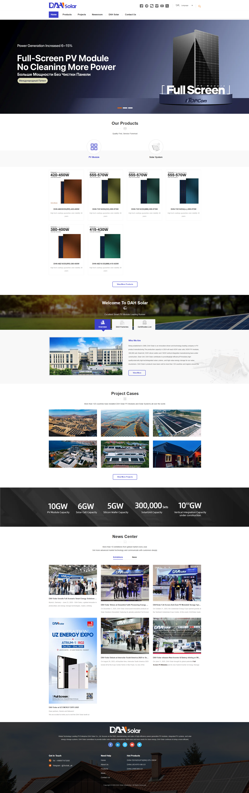
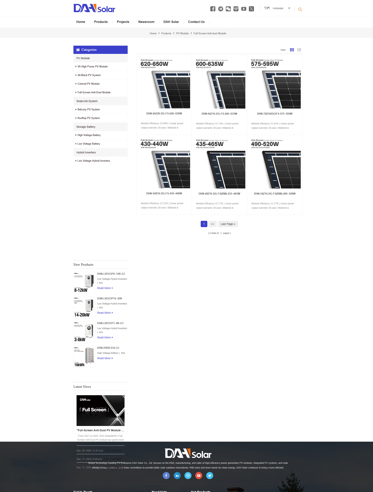
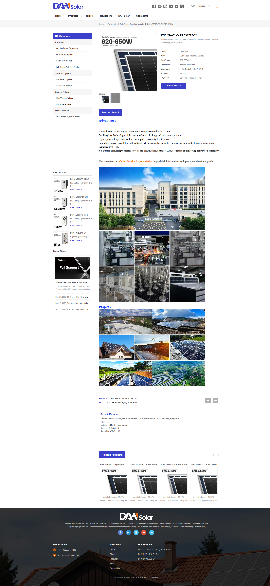
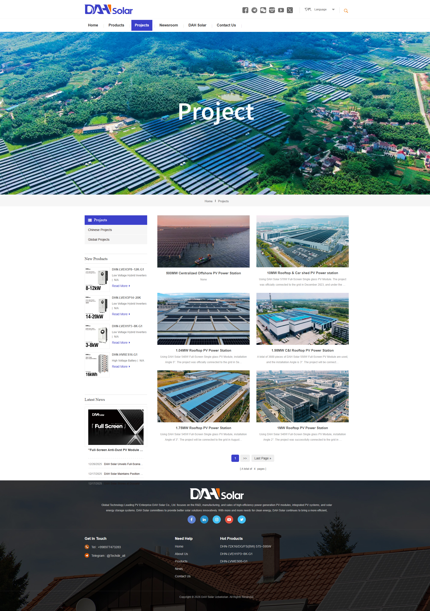
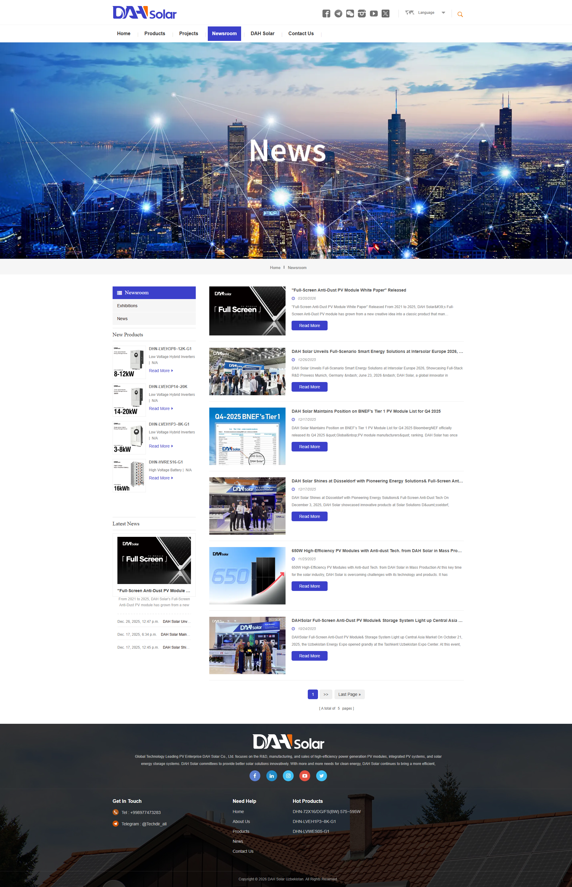

# DAH-Solar

B2C/B2B catalog and corporate website for the official DAH Solar representative in Uzbekistan.

🔗 Live site: [dahsolar.uz](https://dahsolar.uz)

## Screenshots

<p align="center"><b>Home</b></p>
<p align="center"></p>
<p align="center"><b>Products</b></p>
<p align="center"></p>
<p align="center"><b>Product Grid</b></p>
<p align="center"></p>
<p align="center"><b>Projects</b></p>
<p align="center"></p>
<p align="center"><b>News Center</b></p>
<p align="center"></p>

## Overview

A multilingual Django site for a solar panel distributor, covering a product catalog, completed
projects portfolio, company news, and contact forms. Built to run efficiently on modest hardware
(home server deployment) while staying fast and SEO-friendly.

## Features

- **Multilingual content (RU / UZ / EN)** — powered by `django-modeltranslation`, with new or
  edited content automatically translated in the background via Celery tasks (using
  `deep-translator`), so editors only need to fill in one language.
- **View-level caching with Redis** — product, category, type, and news pages are cached and
  automatically invalidated on save, keeping response times low without serving stale content.
- **SEO** — auto-generated `sitemap.xml` (products, projects, news, categories, types, static
  pages), `robots.txt`, canonical URLs, and alt text across the catalog.
- **Optimized image delivery** — all uploaded images are resized and converted to WebP on save
  via `django-resized`, cutting page weight without manual editing.
- **Custom admin (Jazzmin)** — a themed, more usable Django admin for non-technical content
  editors, with app-specific icons and a language switcher.
- **Prometheus monitoring** — `django-prometheus` instruments requests and DB queries for
  operational visibility.

## Tech Stack

| Layer            | Technology                                  |
|-------------------|----------------------------------------------|
| Backend           | Django 5.2                                   |
| Database          | PostgreSQL (SQLite supported for local dev)  |
| Task queue        | Celery + Redis                               |
| Caching           | Redis (`django-redis`)                       |
| Admin UI          | django-jazzmin                               |
| Rich text         | django-ckeditor                              |
| i18n              | django-modeltranslation + deep-translator    |
| Images            | django-resized (WebP)                        |
| Monitoring        | django-prometheus                            |
| Web server (prod) | Gunicorn + Nginx                             |

## Project Structure

```
core/          # Project settings, URLs, sitemaps, Jazzmin config
main/          # Homepage, navbar, banners, search
products/      # Product catalog: brands, categories, types, products
projects/      # Completed projects portfolio
news/          # Company news and categories
contacts/      # Contact form handling
dahsolar/      # Company overview / about pages
```

Each app follows the same pattern: models auto-generate slugs, queue a Celery translation task
on save via `transaction.on_commit`, and invalidate the relevant cache keys.

## Local Setup

**Requirements:** Python 3.11+, PostgreSQL (or SQLite for quick local runs), Redis.

1. Clone the repository and create a virtual environment:
   ```bash
   git clone https://github.com/Djazil4ik/DAH-Solar.git
   cd DAH-Solar
   python -m venv venv
   source venv/bin/activate  # Windows: venv\Scripts\activate
   ```

2. Install dependencies:
   ```bash
   pip install -r requirements.txt
   ```

3. Create a `.env` file in the project root:
   ```env
   SECRET_KEY=your-secret-key
   DEBUG=True
   USE_SQLITE=True

   # Only needed if USE_SQLITE=False
   DB_NAME=dahsolar_db
   DB_USER=postgres
   DB_PASSWORD=your-password
   DB_HOST=127.0.0.1
   DB_PORT=5432

   ALLOWED_HOSTS=localhost,127.0.0.1
   ```

4. Make sure Redis is running locally (used for caching and as the Celery broker):
   ```bash
   redis-server
   ```

5. Run migrations and create a superuser:
   ```bash
   python manage.py migrate
   python manage.py createsuperuser
   ```

6. (Optional) Start a Celery worker for background translation tasks:
   ```bash
   celery -A core worker -l info
   ```

7. Run the development server:
   ```bash
   python manage.py runserver
   ```

The site will be available at `http://127.0.0.1:8000`, with the admin at `/admin/`.

## License

This repository is public for viewing purposes but is **not licensed for reuse, modification,
or redistribution**. All rights reserved.